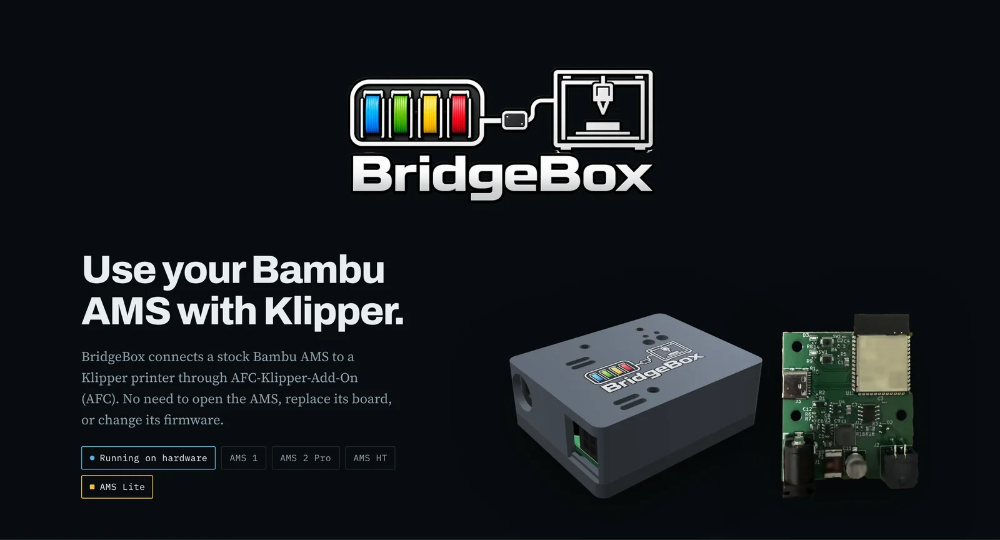
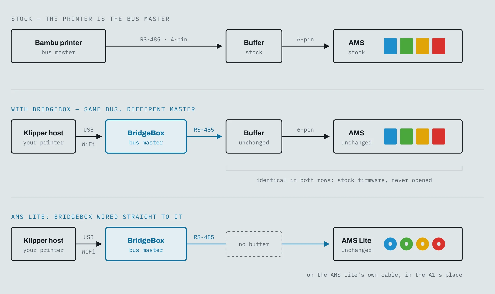
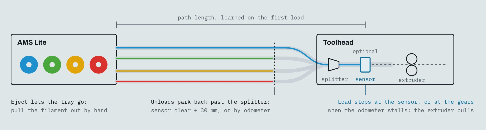

# BridgeBox

BridgeBox connects a stock Bambu AMS to a Klipper printer through AFC-Klipper-Add-On (AFC). No need to open the AMS, replace its board, or change its firmware.

Running on hardware: AMS 1, AMS 2 Pro, AMS HT, and AMS Lite.

The full page: **[j0eb0l.github.io/BridgeBox](https://j0eb0l.github.io/BridgeBox/)**

## Why BridgeBox?

Bambu makes useful AMS hardware, but normally you need a Bambu printer to use it. You can't just plug an AMS into a Klipper machine and expect it to work.

BridgeBox gives Klipper users another option. Whether you're running a Voron, a custom build, or another AFC-compatible printer, you can use an AMS without swapping its electronics.

## How it works

BridgeBox plugs into the four-pin connector on the filament buffer, where a Bambu printer would normally connect. It communicates with the AMS over its existing connection while AFC handles everything from Klipper.

**Nothing on the AMS needs to change.** You don't have to replace a board, flash custom AMS firmware, or open the case. Want to use the AMS with a Bambu printer again? Disconnect BridgeBox and plug the AMS back into it.

<picture>
  <source media="(prefers-color-scheme: dark)" srcset="assets/readme/wiring-dark.webp">
  
</picture>

BridgeBox uses the AMS's existing connections and firmware. The standard AMS keeps its original buffer and cables. The AMS Lite connects directly because it doesn't have a buffer.

## What BridgeBox supports

### Automatic filament changes

Print with multiple colors or materials using Klipper and AFC. AFC handles filament loading, unloading, and changes between tools.

### RFID spool detection

Insert a Bambu-tagged spool and BridgeBox reads its material, color, and temperature information automatically.

With Spoolman 0.27 or newer, each tag is linked to its spool, so the spool is found again in whichever bay it goes into. For a tag Spoolman doesn't know yet, open its Add tag dialog and put the spool in a bay: the scan fills it in. Or turn on `auto_spoolman_create` and AFC makes a new spool from the tag.

### Remaining filament tracking

On supported AMS models, a genuine Bambu RFID spool can be measured to estimate how much filament is left. The result appears in Spoolman and your printer's web interface.

The AMS rotates the spool and uses its encoder and RFID reader to calculate the remaining percentage from one revolution.

This measurement requires a genuine Bambu RFID tag. Other spools still work for printing, but their remaining weight must be entered or tracked separately. The AMS Lite doesn't support this measurement.

### Filament drying

For AMS models with built-in heaters, start or stop drying from your printer interface and monitor temperature and humidity.

Supported AMS models can also rotate spools during drying. The filament needs to be unloaded from the feeder so the spool can turn freely.

### Error detection and recovery

AFC detects failed loads and jams, retries when possible, and pauses the print if it can't recover.

If BridgeBox loses its connection during a print, AFC pauses the job. Short interruptions during a filament load have a separate timeout.

When filament runs out, AFC can pause the print or switch to a configured backup lane. The AMS can then feed out the remaining filament for removal.

### Multiple AMS units

A single BridgeBox supports up to four AMS 1/AMS 2 Pro units plus eight AMS HT units, for a total of 24 filament slots. This limit comes from the AMS bus addressing system.

You can add another BridgeBox if you need more slots. AFC keeps the units and tool assignments separate.

## AMS model comparison

All four models work with BridgeBox and AFC. The differences below come from each AMS model's hardware and filament path.

| Feature | AMS 1 | AMS 2 Pro | AMS HT | AMS Lite |
|---|---|---|---|---|
| Spool slots | 4 | 4 | 1 | 4 |
| Connection | Stock buffer; shared bus | Stock buffer; shared bus | Stock buffer; shared bus | Direct cable; dedicated BridgeBox |
| Multiple units | Up to 4 enclosed units total | Up to 4 enclosed units total | Up to 8 HT units | One Lite per BridgeBox |
| Toolhead sensing | AMS buffer; printer sensors configured in AFC | AMS buffer; printer sensors configured in AFC | AMS buffer; printer sensors configured in AFC | Optional toolhead sensor; odometer can detect arrival |
| Buffer / hub | Stock AMS buffer | Stock AMS buffer | Stock AMS buffer | No stock buffer; optional external buffer |
| RFID tags | Material, color, temperatures, spool identity | Material, color, temperatures, spool identity | Material, color, temperatures, spool identity | Material, color, temperatures, UID and reel UUID |
| Untagged spools | Supported; set lane details | Supported; set lane details | Supported; set lane details | Supported; set lane details |
| Drying | No built-in heater | Built-in heater; up to 65 °C | Built-in heater; up to 85 °C | No built-in heater |
| Temperature / humidity | Model-dependent reporting | Temperature and humidity reporting | Temperature and humidity reporting | No built-in humidity sensor |
| Remaining filament | Estimate on supported tagged spools | Estimate on supported tagged spools | Estimate on supported tagged spools | Uses Spoolman or manually set weight |
| Load / unload | Controlled through AFC | Controlled through AFC | Controlled through AFC | Controlled through AFC; parks filament clear of splitter |
| Path management | AFC configuration and sensors | AFC configuration and sensors | AFC configuration and sensors | Learns path on first load via odometer |
| Overfeed protection | AFC loading limits and sensor checks | AFC loading limits and sensor checks | AFC loading limits and sensor checks | Stops 250 mm past learned path |
| Jam handling | AFC detects and handles failed loads | AFC detects and handles failed loads | AFC detects and handles failed loads | AMS Lite stall reporting and AFC handling |
| Filament grip / clogs | Printer/AFC sensor configuration | Printer/AFC sensor configuration | Printer/AFC sensor configuration | Odometer checks movement and can trigger AFC pause |
| Stuck spool | AMS errors handled by AFC | AMS errors handled by AFC | AMS errors handled by AFC | AMS Lite reports stuck/tangled spool |

## AMS Lite support

The AMS Lite is the four-spool system used with the Bambu A1 series. Since it doesn't have a buffer or built-in dryer, its setup is different from the enclosed AMS models.

**It has its BridgeBox to itself.** BridgeBox goes on the AMS Lite's cable in the A1's place. Nothing else can share that bus, and AFC refuses a setup that tries, so boxed units and HTs go on a second BridgeBox on the same printer.

**A toolhead sensor is optional.** A boxed AMS feels the filament arrive at its buffer. An AMS Lite has nothing like that, so it feeds until the filament reaches the toolhead, then lets go and the extruder pulls, the same way an A1 runs it. Its four tubes meet at a splitter at the toolhead. A filament switch after the splitter, before the extruder gears, ends every load for all four trays, and on a Snapmaker U1 the U1's own sensor counts. Without one, the AMS Lite's own odometer ends the load: when the tip reaches the extruder gears it stops moving, and the feed stops there.

**It learns its own path.** On the first load it measures the run from the AMS Lite to the sensor, or to the gears, with its odometer and keeps that figure. After that, a load that feeds 250 mm past it without arriving is stopped, instead of pushing filament somewhere it shouldn't go. A feed that stops well short of it isn't taken as arrived. BridgeBox waits for the AMS Lite's own stall report and only then fails the load as a jam, so a brief hesitation never stops a print.

**The odometer keeps watch.** The AMS Lite counts the filament leaving each tray in 1.5 mm steps, even with its motor off. Once a load ends, the extruder takes over, and the count has to move with it. That proves the gears have hold of the filament; if the count stands still, the load fails instead of printing into the air. While printing, an extruder that keeps pushing while the count stands still means a clog, and AFC pauses the print. The AMS Lite reports a stuck or tangled spool itself, and BridgeBox stops the load and names the tray.

**Tags work as on the other units.** When a spool goes in, BridgeBox asks the AMS Lite to read its tag, the way an A1 does. A Bambu tag brings the material, color, temperatures and spool weight, along with the tag's own UID and the reel's UUID, so Spoolman links the spool and finds it again in any tray. An untagged spool loads and prints the same; you set the lane.

**It doesn't measure what's left.** A boxed AMS can turn a tagged spool to measure it. The AMS Lite can't, and it doesn't on an A1 either, so its lanes keep the weight Spoolman or you set.

**Unloads stop short.** Its spring-loaded holders take back only a little filament, so it never reels the tube home. With a sensor, it pulls back until the sensor clears, then 30 mm more (set that to clear your splitter). Without one, it pulls back a set distance, counted on the odometer. Either way it parks there, out of the other trays' way and ready for its next load. To take a spool out, eject the lane: the AMS Lite lets go and you pull the filament out by hand.

<picture>
  <source media="(prefers-color-scheme: dark)" srcset="assets/readme/ams-lite-dark.webp">
  
</picture>

Not to scale. All four trays share the splitter and the toolhead sensor, if there is one. A load ends at the sensor, or without one where the odometer stalls at the extruder gears, and an unload pulls back just far enough to clear the splitter instead of reeling the tube home.

## What you'll need

### A Klipper printer running AFC

BridgeBox works with [AFC-Klipper-Add-On](https://github.com/AFCProject/AFC-Klipper-Add-On). If you already run AFC with a BoxTurtle or similar, an AMS becomes another thing it can drive.

### A 24 V 2–4 A supply

The AMS was powered by the printer; now it needs its own — the one thing not in the box. Any 24 V adapter from 2 to 4 A does it: the draw stays under 1 A even with an AMS 2 Pro drying on it, and a 2 A fuse on the board holds the ceiling whatever you plug in. The barrel matches an AMS 2 Pro's own adapter, so a spare one goes straight in. Buying rather than raiding a drawer? One AMS 2 Pro can dry off this supply; any other unit drying at the same time needs an adapter of its own.

### One dryer can run off the bridge

One AMS 2 Pro can dry on the bridge's own supply, over the same wire as everything else. A second one heating off that wire would pull the supply down and reset every unit on it, so AFC won't start it while the first is drying on bridge power. Plug an adapter into either one, even mid-cycle, and the block lifts. An AMS HT always needs its own mains cord to heat.

### USB or WiFi, with nothing to type

Plug BridgeBox in over USB and AFC finds it by itself, with no serial port to look up. For WiFi, join the hotspot BridgeBox puts up, pick your network on the page it shows, and Klipper gives it a private key, so there is no key to type. Start it on USB and it moves over to WiFi by itself once it has joined. To move it to another printer, AFC can clear its WiFi, or you can hold its button for ten seconds.

### One config section, then swap units freely

This is a maker's product, not an appliance, so there is Klipper config to set up. Only once, though: AFC's installer writes one BridgeBox section, and that section builds every unit, bay and sensor for you. After that the hardware is yours to rearrange. Plug an AMS in or pull one out while everything is running and it claims its own bays there and then — spare bays are held open for exactly that, so the ones you already had never shift and your Spoolman spools and tool numbers stay put.

### An AMS Lite needs a BridgeBox of its own

Nothing else can share its bus, so boxed units and HTs go on a second BridgeBox. A toolhead sensor is optional: a filament switch after the splitter its four tubes share ends each load (on a Snapmaker U1, the U1's own sensor), and without one the AMS Lite's odometer finds the extruder gears. The [AMS Lite section](#the-a1s-ams-lite-on-a-bridgebox-of-its-own) has the rest.

## Technical specifications

| | |
|---|---|
| **Works with** | Bambu Lab AMS 1 · AMS 2 Pro · AMS HT · AMS Lite, all stock and unmodified |
| **How many** | 4 boxed units + 8 HT per BridgeBox, 24 bays (Bambu's limit, not ours), or one AMS Lite on its own. A printer can run more than one BridgeBox |
| **Connects at** | The filament buffer's 4-pin socket, the printer's own plug. On an AMS Lite, its cable in the A1's place |
| **Bus** | RS-485, half-duplex, 1,228,800 baud |
| **Link to the printer** | USB or WiFi, plain text. Found by itself on USB; WiFi set up from its own hotspot, with no key to type. The host never touches the bus |
| **Power** | 24 V, 2–4 A adapter (not included). 2 A fuse on the board. Same barrel as an AMS 2 Pro's. One AMS 2 Pro may dry on it; other dryers need their own supply |
| **Addressing** | Boxed units claim 0x00–0x03, HT units 0x80–0x87, at power-up. An AMS Lite has the bus to itself |
| **If the link drops** | Print pauses after 5 s of silence; a load in progress rides out 12 s |
| **Enclosure** | 3D-printed enclosure; STL files included |
| **Updates** | Over USB, or over the air on WiFi. Ships flashed, so an update never needs a button held |
| **Reversible** | Nothing on the AMS is modified. Unplug it and it goes back on a Bambu printer |

## Optional touchscreen display

Use a compatible 5-inch touchscreen to check filament slots, loaded spools, and drying status without opening Mainsail or Fluidd.

**This one is firmware, not hardware.** It is an image you flash onto a BTT Panda Touch or K-Touch — the same board under two names, sold as a Bambu accessory — which turns it into a display for your printer instead. If one is already sitting in a drawer since you stopped using it, that is the whole cost of this.

It follows every unit on the bridge, all twelve if you have them, one on the screen at a time. The Unit button at the top opens a list of them with each bay's color and material, so you can see the whole chain at a glance and tap the one you want.

**Not only the AMS.** Tick *All AFC units* in that list and every other unit AFC runs joins it: Box Turtle, Night Owl, Quattro Box, EMU, HTLF, ViViD, Claymore, ACE, ACE 2, OpenAMS, a toolchanger's tools. Each gets the same card, with its lanes, spools and weights, the box temperature and humidity when it reports them, and its buffer when it has one. A lane with an AFC RFID reader, on an ACE 2, an OpenAMS, a ViViD or a Box Turtle, gets Scan Tag too, which reads the tag where the spool sits and fills in the lane. A unit with more than four lanes pages through them four at a time.

Every bay tile shows the filament, how full the spool is, its print temperatures and Spoolman spool. Its T# / Runout button sets the tool number and the infinite-runout lane from any lane on the printer, and Scan Tag reads the spool's tag. It dims itself when it has been left alone, and a tap brings it straight back.

**Heater control on the units that have one.** An AMS 2 Pro, an AMS HT, an Anycubic ACE and an ACE 2 each get a Dryer Menu on their card: pick a temperature and a time, start or stop a cycle, and the card shows it drying and at what temperature. It sends the same commands as AFC's own dryer page and offers only what each unit accepts: up to 65 °C on an AMS 2 Pro, 85 °C on an HT, the ACE's configured ceiling, and spool rotation where the AMS supports it. Units without a heater show their temperature and humidity only.

The touchscreen connects over Wi-Fi and doesn't control the filament bus directly. Disconnecting the display won't interrupt a print.

<picture>
  <source media="(prefers-color-scheme: dark)" srcset="assets/readme/panel-dark.webp">
  
</picture>

The panel's own screens, rendered from its firmware. One unit fills the screen at a time; the Unit button opens a list of every unit on the bridge, and with All AFC units ticked, every other AFC unit on the printer too, like the ACE 2 at the bottom, with its own Dryer Menu and Scan Tag.

## Development status

All features described here have been tested and proven functional. Development is ongoing, and while these features are working, some may not be fully integrated or available in the initial release. Additional functionality will be introduced as development continues.

## Developed in collaboration with AFC

BridgeBox was developed in conjunction with the AFC team to bring Bambu AMS support to Klipper-based printers. While the AFC-Klipper-Add-On project is open source, the BridgeBox transport component is proprietary and licensed exclusively to the AFC project. A big thank you to the AFC team for their collaboration, support, and contributions throughout development.

- [AFC-Klipper-Add-On on GitHub](https://github.com/AFCProject/AFC-Klipper-Add-On)
- [AFC documentation](https://www.afcproject.dev/)

---

**BridgeBox** — use your Bambu AMS with Klipper. Available soon.
