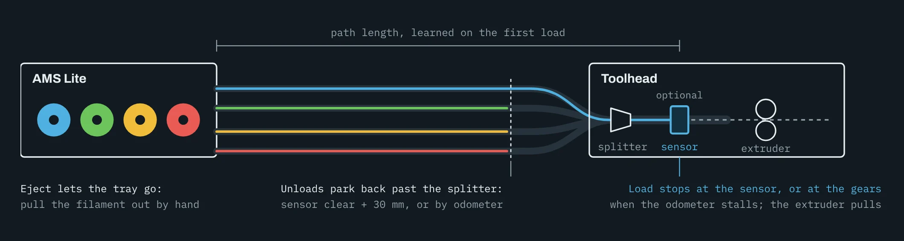

# AMS Lite

!!! warning "In testing"

    AMS Lite support runs on test hardware but is not in the current AFC release, and the installer does not offer it
    yet. This page describes how it works so you know what to expect.

The AMS Lite is the four-spool system from the Bambu A1 series. It has no buffer and no dryer, so it is set up
differently from the boxed units.

<figure markdown="span">
  { loading=lazy }
  { loading=lazy }
  <figcaption>Not to scale. All four trays share the splitter and the toolhead sensor, if there is one.</figcaption>
</figure>

## A BridgeBox of its own

BridgeBox goes on the AMS Lite's cable, in the place of the A1. Nothing else can share that bus, and AFC refuses a
setup that tries. Boxed units and AMS HT units go on a second BridgeBox on the same printer.

## Loading

The AMS Lite's four tubes meet at a splitter at the toolhead.

=== "With a toolhead sensor"

    A filament switch after the splitter, before the extruder gears, ends every load for all four trays. On a
    Snapmaker U1, the U1's own toolhead sensor counts.

=== "Without a toolhead sensor"

    The AMS Lite's own odometer ends the load: when the tip reaches the extruder gears it stops moving, and the feed
    stops there. Then the AMS Lite lets go and the extruder pulls, the same way an A1 runs it.

### It learns its own path

On the first load, the AMS Lite measures the run to the sensor, or to the gears, with its odometer and keeps that
figure. After that:

- a load that feeds 250 mm past it without arriving is stopped, instead of pushing filament somewhere it shouldn't go;
- a feed that stops well short of it isn't taken as arrived;
- a jam only fails the load once the AMS Lite reports a stall itself, so a brief hesitation never stops a print.

## The odometer keeps watch

The AMS Lite counts the filament leaving each tray in 1.5 mm steps, even with its motor off.

- Once a load ends, the count has to move with the extruder. That proves the gears have hold of the filament; if the
  count stands still, the load fails instead of printing into the air.
- While printing, an extruder that keeps pushing while the count stands still means a clog, and AFC pauses the print.
- The AMS Lite reports a stuck or tangled spool itself. BridgeBox stops the load and names the tray.

## Unloading

The spring-loaded holders take back only a little filament, so the AMS Lite never reels the tube home.

=== "With a toolhead sensor"

    It pulls back until the sensor clears, then 30 mm more. Set that distance to clear your splitter.

=== "Without a toolhead sensor"

    It pulls back a set distance, counted on the odometer.

Either way it parks there, out of the other trays' way and ready for its next load. To take a spool out, eject the
lane: the AMS Lite lets go and you pull the filament out by hand.

## Tags

When a spool goes in, BridgeBox asks the AMS Lite to read its tag, the way an A1 does. A Bambu tag brings the material,
color, temperatures and spool weight, along with the tag's UID and the reel's UUID, so Spoolman links the spool and
finds it again in any tray. An untagged spool loads and prints the same; you set the lane.

## What it doesn't do

- **No measuring.** The AMS Lite can't measure what is left on a spool, on an A1 or on a BridgeBox. Its lanes keep the
  weight Spoolman or you set.
- **No drying, no humidity.** It has no heater and no humidity sensor.
