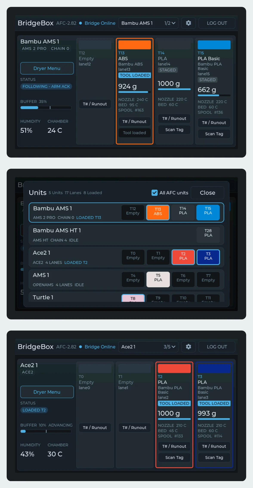
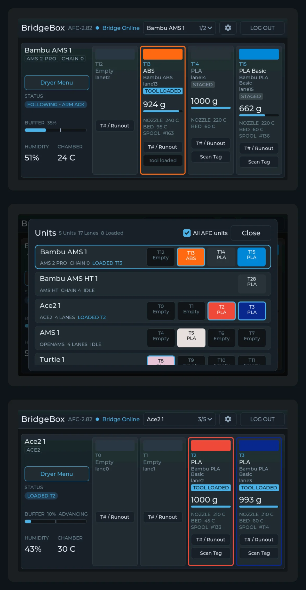

# Touchscreen Display

The BridgeBox display is an optional 5-inch touchscreen that shows what your units hold: each bay's color, material,
weight and state, each unit's temperature and humidity, and the dryer controls one tap away.

**It is firmware, not hardware.** It is an image you flash onto a **BTT K-Touch**. A **BTT Panda Touch** is the same
board under another name, so one left over from a Bambu printer works too.

<figure markdown="span">
  { width="520" loading=lazy }
  { width="520" loading=lazy }
  <figcaption>The home screen, the unit list with All AFC units ticked, and an ACE 2 card.</figcaption>
</figure>

!!! note

    The display reads the printer through Moonraker over WiFi. It never touches the AMS bus, so unplugging it, even
    mid-print, changes nothing on the printer.

## What it shows

- **One unit at a time.** The **Unit** button in the top bar names the unit on screen. Tap it for a list of every unit
  with its bays, then tap a unit to show it.
- **Every bay.** Each tile shows the filament, how full the spool is, its print temperatures and its Spoolman spool.
  Its **T# / Runout** button sets the tool number and the infinite-runout lane, from any lane on the printer, and
  **Scan Tag** reads the spool's tag.
- **All AFC units.** Tick **All AFC units** in the unit list and the printer's other AFC units join it: BoxTurtle,
  NightOwl, QuattroBox, EMU, HTLF, ViViD, ACE, ACE 2, OpenAMS and a toolchanger's tools. Each gets the same card, with
  its buffer when it has one.
- **Dryer Menu.** An AMS 2 Pro, AMS HT, ACE or ACE 2 card has a Dryer Menu: pick a temperature and time, then start or
  stop a cycle. It only offers what each unit accepts.

## The files

Both are in `Firmwares/BridgeBox_Display/` in the AFC-Klipper-Add-On folder.

| File | Flash at | Keeps saved WiFi and printer | Use it for |
|------|----------|------------------------------|------------|
| `bridgebox-full-0x0.bin` | `0x0` | No | The first flash, and recovery |
| `bridgebox-update-app-0x10000.bin` | `0x10000` | Yes | Every update after that |

## First flash

This replaces the stock BTT firmware. You need a computer with Python and esptool (`pip install esptool`).

1. **Connect the panel's USB-C to the computer.** It shows up as a CH340 serial port: `/dev/ttyUSB0` on Linux, a `COM`
   port on Windows, `/dev/cu.wchusbserial...` on a Mac. Use your port in place of `/dev/ttyUSB0` below.
2. **Check it is the right board.** This only reads:

    ```bash
    esptool.py -p /dev/ttyUSB0 flash_id
    ```

    Look for `Chip is ESP32-S3` and a 16 MB flash.

3. **Flash the full image:**

    ```bash
    esptool.py -p /dev/ttyUSB0 -b 460800 write_flash 0x0 bridgebox-full-0x0.bin
    ```

    The panel restarts into setup.

!!! tip

    Newer esptool installs name the command `esptool` instead of `esptool.py`. The rest of the line is the same.

## Setup on the panel

The panel walks through this on its first start:

1. **Choose your network** and enter its password. Leave it blank for an open network.
2. **Moonraker address:** the printer the BridgeBox is plugged into, for example `http://192.168.1.50`.
3. **Port:** `7125` unless you moved Moonraker.
4. **API key:** usually blank.

It saves, restarts and connects. The units appear by themselves once the printer reports them.

To move the panel to another network or printer, press **Log out** in the top bar and confirm.

## Updating

Both ways keep the saved network and printer.

=== "From a browser"

    The panel serves its own update page; its address is on the Settings sheet (the cog in the top bar). Open that
    address, choose `bridgebox-update-app-0x10000.bin` on the **Panel** card and press **Update panel**.

=== "Over USB"

    ```bash
    esptool.py -p /dev/ttyUSB0 -b 460800 write_flash 0x10000 bridgebox-update-app-0x10000.bin
    ```

If a new version fails to start, the panel goes back to the version it was running.

## What can go wrong

| The panel shows | Meaning |
|-----------------|---------|
| `No WiFi` | It cannot join the saved network. Log out and run setup again. |
| `No answer at that address` | The Moonraker address or port is wrong, or the printer is off. |
| `HTTP 401 -- API key?` | Moonraker does not trust the panel. Add the panel's network to `trusted_clients` under `[authorization]` in `moonraker.conf`, or log out and enter Moonraker's API key in setup. |
| No units | Check the units show online in Mainsail or Fluidd first. |
| Nothing, or it keeps restarting, after a USB flash | Flash the full image again. |

[Next step: Klipper Commands](commands.md){ .md-button }
