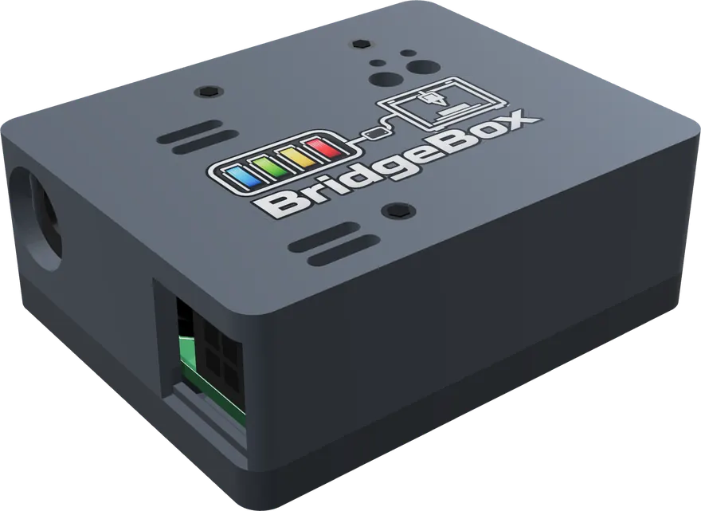
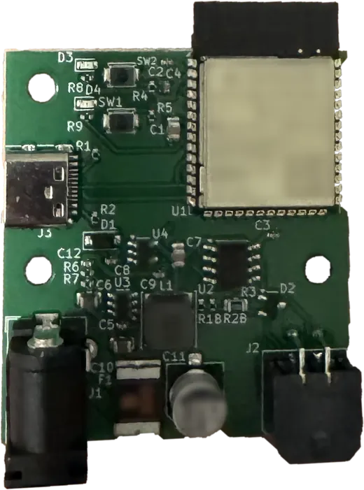

# Hardware and Wiring

<figure markdown="span">
  { width="420" loading=lazy }
</figure>

## Connecting the AMS

BridgeBox connects at the same place a Bambu printer does: the four-pin socket on the AMS filament buffer. Unplug
the printer's cable from the buffer and plug the BridgeBox cable in its place.

- **Boxed units (AMS 1, AMS 2 Pro) and AMS HT:** keep the stock buffer and the stock cables between units. Connect
  the units to each other exactly as they would be on a Bambu printer. BridgeBox finds every unit on the bus by itself.
- **AMS Lite:** it has no buffer. BridgeBox goes on the AMS Lite's own cable, in the place of the A1, and nothing else
  can share that bus. See [AMS Lite](ams-lite.md).

!!! note

    The bus between the BridgeBox and the AMS units is RS-485 at 1,228,800 baud, the same as on a Bambu printer. Klipper
    never touches the bus; it only talks to the BridgeBox.

## Power

The AMS units were powered by the Bambu printer. On a BridgeBox they are powered by the BridgeBox, which needs its own
supply.

- Use a **24 V adapter rated 2 to 4 A**. The draw stays under 1 A even with an AMS 2 Pro drying on it, and a 2 A fuse
  on the board limits it no matter which adapter you plug in.
- The barrel connector matches the AMS 2 Pro's own adapter, so a spare one fits.

!!! warning "Drying on BridgeBox power"

    One AMS 2 Pro can dry on the BridgeBox's supply. A second unit heating off the same wire would pull the supply down
    and reset every unit on the bus, so AFC will not start it while the first one is drying on bridge power. Plug an
    adapter into either unit, even mid-cycle, and the block lifts. An AMS HT always needs its own mains cord to heat.

## Connecting to Klipper

BridgeBox talks to Klipper over **USB** or **WiFi**.

=== "USB"

    Plug the BridgeBox into the Klipper host with a USB cable. With `serial_port: auto`, AFC finds it by itself; there
    is no serial port to look up.

=== "WiFi"

    BridgeBox joins your network from its own setup hotspot. You can start on USB and let it move to WiFi by itself,
    or run it on WiFi alone. See [USB and WiFi](connection.md).

BridgeBox is **not** a Klipper `[mcu]`. Never add it to an `[mcu]` section or flash Klipper onto it.

## The BOOT button

Holding the BOOT button for **10 seconds** wipes the BridgeBox's WiFi network and link key and restarts it with its
setup hotspot. The LED flickers after one second of holding so you know it took. Use this when moving the BridgeBox to
another printer or network without Klipper. `AFC_BRIDGEBOX_RESET_WIFI` does the same from Klipper.

## The enclosure

BridgeBox comes in a 3D-printed case. The STL files are included, so you can print a replacement or a case in your own
colors.

<figure markdown="span">
  { width="420" loading=lazy }
</figure>

## Toolhead sensor

Each AMS feeds a load until the extruder's toolhead sensor (`pin_tool_start` in its `[AFC_extruder]`) sees filament,
then hands over to the extruder. The extruder a BridgeBox feeds needs either a toolhead sensor or
`pin_tool_start: buffer` with the BridgeBox buffer standing in for one. See
[Configuration](configuration.md#extruder).

[Next step: Installation](installation.md){ .md-button }
