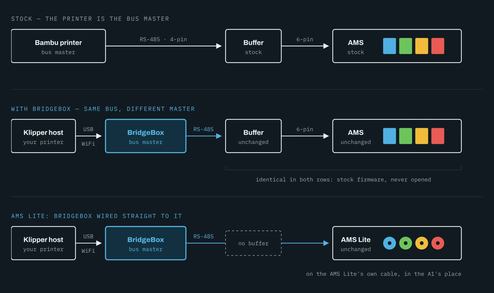

# BridgeBox Overview

BridgeBox lets the AFC-Klipper-Add-On drive stock Bambu Lab AMS units. It plugs into the AMS bus in the place of a
Bambu printer and talks to the units over their own connection, while AFC handles loading, unloading, tool changes,
spool data and drying from Klipper.

**Nothing on the AMS needs to change.** There is no board to replace, no custom AMS firmware to flash and no case to
open. To use an AMS with a Bambu printer again, unplug it from the BridgeBox and plug it back into the printer.

## Supported units

| Unit | Lanes | On a BridgeBox | Dryer |
|------|-------|----------------|-------|
| AMS 1 | 4 | Up to 4 boxed units per BridgeBox | No |
| AMS 2 Pro | 4 | Up to 4 boxed units per BridgeBox | Yes, up to 65 °C |
| AMS HT | 1 | Up to 8 per BridgeBox | Yes, up to 85 °C |
| AMS Lite | 4 | One, on a BridgeBox of its own | No |

A single BridgeBox runs up to four boxed units (AMS 1 and AMS 2 Pro in any mix) plus eight AMS HT units, for a total
of 24 lanes. That limit comes from how Bambu addresses units on the bus, not from AFC. You can add a second BridgeBox
to the same printer if you need more lanes or a second extruder.

!!! warning "AMS Lite"

    AMS Lite support is still being tested and is not in the current AFC release. See [AMS Lite](ams-lite.md) for how
    it works and what is different about it.

## How it works

<figure markdown="span">
  { loading=lazy }
  { loading=lazy }
  <figcaption>BridgeBox uses the AMS's existing buffer, cables and firmware. An AMS Lite has no buffer, so BridgeBox
  is wired straight to it.</figcaption>
</figure>

- BridgeBox plugs into the four-pin socket on the AMS filament buffer, where the Bambu printer's cable normally goes.
  It is the master of the RS-485 bus, the same as a Bambu printer would be.
- Klipper talks to BridgeBox over USB or WiFi. BridgeBox is not a Klipper `[mcu]` and needs no Klipper firmware.
- AFC builds a unit, lanes and a hub for every AMS on the bus from a single `[AFC_BridgeBox]` section. Units can be
  plugged in or pulled out while Klipper runs, and their lanes and `T#` come and go by themselves.
- Each AMS feeds filament until the extruder's toolhead sensor sees it, then hands over to the extruder.

## What BridgeBox supports

### Automatic filament changes

Print with multiple colors or materials. AFC handles loading, unloading and changes between lanes, the same as with
any other AFC unit.

### RFID spool detection

Insert a spool with a Bambu tag and the AMS reads its material, color and temperatures. With Spoolman 0.27 or newer,
each tag is linked to its spool so the spool is found again in whichever bay it goes into. See
[Spools, RFID and Spoolman](spools.md).

### Remaining filament

On the boxed units, a spool with a genuine Bambu tag can be measured to estimate how much filament is left. The result
shows up in Spoolman and in your printer's web interface.

### Drying

On the AMS 2 Pro and the AMS HT, start and stop drying from Klipper and watch temperature and humidity. See
[Drying](drying.md).

### Error detection and recovery

AFC detects failed loads and jams, retries when it can and pauses the print when it can't. If the BridgeBox link drops
during a print, AFC pauses the print after 5 seconds of silence; a load in progress rides out 12 seconds.

When filament runs out, AFC can pause the print or switch to a runout lane, as with any other AFC unit.

### Hot-swap

Plug a unit in while Klipper runs and it claims a bay, with its lanes and `T#` showing up right away. Each unit
remembers its bay, so it comes back on the same lanes and `T#` after a restart. See
[Bays, Lanes and Hot-Swap](bays.md).

## What you'll need

- A Klipper printer running the AFC-Klipper-Add-On.
- A BridgeBox and a 24 V power supply for it. See [Hardware and Wiring](hardware.md).
- One or more Bambu AMS units with their stock buffer and cables.
- A toolhead filament sensor on the extruder the AMS feeds, or the AMS buffer standing in for one (see
  [Configuration](configuration.md#extruder)).
- Optionally, Spoolman 0.27 or newer for spool tracking.

[Next step: Hardware and Wiring](hardware.md){ .md-button }
